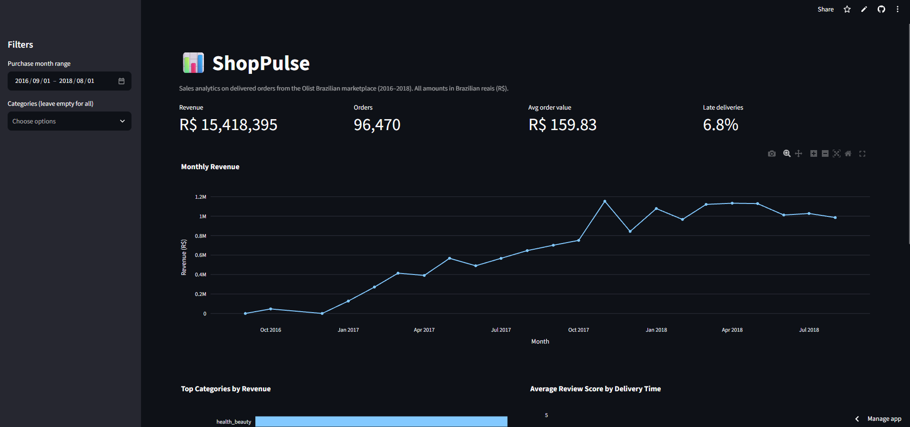
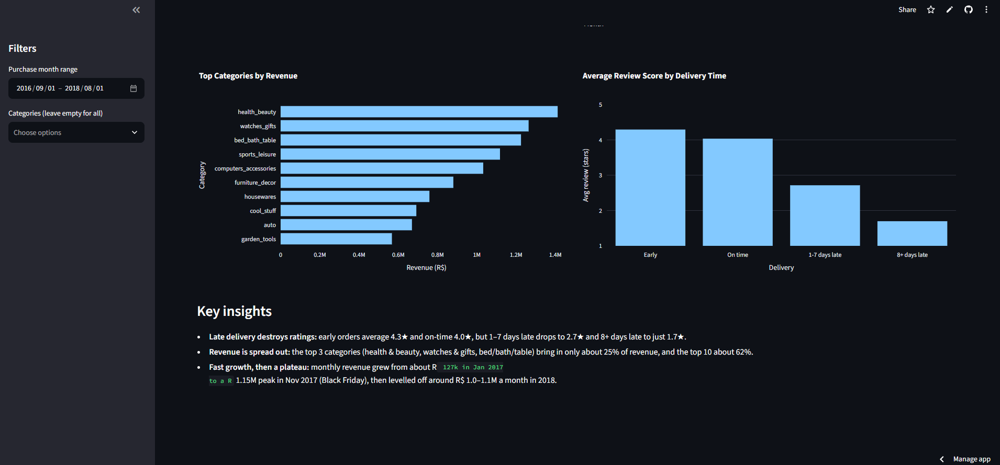
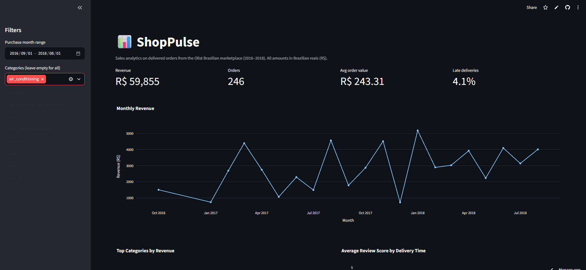

#  ShopPulse: E-commerce Sales Analytics Dashboard

🔗 **Live demo:** [shoppulseai](https://shoppulseai.streamlit.app/)

An interactive dashboard that turns 110K+ raw order records from a Brazilian online
marketplace into revenue trends, top-category rankings, and delivery-performance insights.





Filtering by category (here, air conditioning) updates every KPI and chart:



## Key Insights
-   **Late deliveries:** orders delivered 8+ days late averaged **1.7 stars** vs **4.3** for early deliveries
-   **Top category:** health_beauty generated the most revenue (**R$ 1.41M**, about 9% of the total)
-   **Trend:** monthly revenue grew from about R$ 127k in Jan 2017 to a R$ 1.15M peak in Nov 2017 (Black Friday), then levelled off around R$ 1.0–1.1M a month in 2018

## Headline Numbers
| Metric | Value |
|---|---|
| Delivered orders | 96,470 |
| Total revenue | R$ 15.4M |
| Average order value | R$ 159.83 |
| Late delivery rate | 6.8% |

## Features
- KPI cards: revenue, orders, average order value, late-delivery rate
- Monthly revenue trend
- Top 10 product categories
- Delivery delay vs. customer review score
- Filters by date range and category

##  Data Cleaning Decisions
- Kept only **delivered** orders; canceled or in-transit orders aren't real revenue
- Dropped 8 delivered orders with no delivery date (delay can't be measured)
- Revenue = item price + freight, calculated at item level
- Orders counted with unique order IDs (one order can contain several items)
- Reviews averaged per order before merging, to avoid double-counting

##  Tech Stack
Python · pandas · Plotly · Streamlit · Parquet · pytest

##  Run Locally
```bash
git clone https://github.com/Aribdebugs/shoppulse.git
cd shoppulse
python -m venv .venv
.venv\Scripts\activate          # Mac/Linux: source .venv/bin/activate
pip install -r requirements.txt
streamlit run app.py
```

To rebuild the data from scratch, download the
[Olist dataset](https://www.kaggle.com/datasets/olistbr/brazilian-ecommerce) into
`data/raw/dataset/` and run `python src/clean.py`.

## 🧪 Tests
```bash
pip install pytest
pytest
```

## 📁 Project Structure
```
shoppulse/
├── app.py # Streamlit dashboard
├── src/
│ ├── load_data.py # read raw CSVs
│ ├── clean.py # clean + merge into one table
│ ├── metrics.py # KPI calculations
│ └── charts.py # Plotly charts
├── tests/ # unit tests for metrics
├── notebooks/ # exploration
└── data/processed/ # cleaned data used by the app
```

## 🔮 Future Improvements
- Revenue forecasting
- Customer segmentation
- Connect to the ShopLab store as its admin analytics page